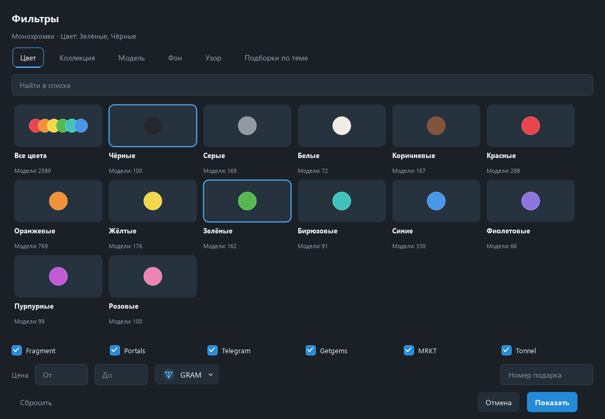

<p align="center">
  
</p>

<h1 align="center">GiftFinder</h1>

<p align="center">Коллекционные подарки Telegram — поиск и сравнение цен в приложении для Windows.</p>

<p align="center">
  <strong>Qt Widgets · Windows x64 · Portable · 28 языков</strong>
</p>

<p align="center">
  <a href="https://github.com/Misha20062006/giftfinder/releases/latest">Скачать для Windows</a>
  &nbsp;·&nbsp;
  <a href="docs/USER_GUIDE.md">Руководство</a>
  &nbsp;·&nbsp;
  <a href="docs/RELEASE_NOTES.md">Что нового</a>
</p>


## Найти нужное сочетание

Выберите коллекцию, модель, фон или узор из готового каталога. Сравните найденные предложения разных площадок, сохраните поиск или добавьте подарок в избранное.

| Возможность | Что доступно |
|---|---|
| Точные фильтры | Коллекция, модель, фон, узор, номер, площадка и диапазон цены |
| Тематические подборки | Minecraft, сырные, арбузные, сакура и другие визуально проверенные группы |
| Монохромки | Сочетания модели и фона близкого цвета; выбор одной или нескольких из 13 цветовых групп |
| Цены | GRAM, Stars и приблизительный пересчёт в 166 обычных валют с источником и датой курса |
| Языки | 28 языковых вариантов; по умолчанию используется язык системы |
| Локальные данные | Кеш предложений, избранное, сохранённые поиски и экспорт CSV |
| Интерфейс Windows | Растягиваемые окна фильтров, плавная прокрутка и анимации с учётом уменьшения движения |

Встроенный каталог на **24 октября 2026 года**: 123 коллекции, 7 806 моделей и 80 фонов. Метаданные обновляются в фоне. Монохромки — самостоятельная приблизительная группировка, а не официальный атрибут Telegram.

<details>
<summary><strong>Выбор цвета монохромок</strong></summary>



Нажатие «Монохромки» открывает палитру. Выберите цвета и нажмите «Показать». Пока выбор не применён, действующий поиск сохраняется.

</details>

## Запуск

1. Откройте [последний релиз](https://github.com/Misha20062006/giftfinder/releases/latest).
2. Скачайте `GiftFinder-0.6-Windows.zip` и распакуйте его в удобную папку.
3. Запустите `GiftFinder.exe`. Python и права администратора не требуются.

В релизе также доступен отдельный EXE. Сборка portable и без цифровой подписи. Настройки, избранное и история поисков хранятся в `%LOCALAPPDATA%\GiftFinder\GiftFinder`; замена EXE сохраняет этот профиль.

## Откуда приходят предложения

| Площадка | Подключение в версии 0.6 |
|---|---|
| Fragment | Прямой публичный поиск с догрузкой страниц |
| Portals | Прямой публичный API с догрузкой страниц |
| Telegram, Getgems, MRKT, Tonnel | Индекс browse.tg / Gift Satellite |

Происхождение и время данных показываются в приложении. Индекс и кеш могут содержать ограниченную или устаревшую выдачу: полный охват рынка и глобальная минимальная цена не гарантируются. Шкала поиска отражает завершение поисковых проверок, а не процент всех предложений на площадках.

**Прямое подключение к Gift Satellite в эту версию не входит.** Приложение предназначено для поиска: покупки, сообщения и чтение пользовательских сессий Telegram не выполняются.

Подробности: [устройство поиска](SEARCH_TECHNICAL.txt), [руководство](docs/USER_GUIDE.md).

## Стек и исходники

Python 3.12, PySide6 / Qt Widgets, Requests, Beautiful Soup и SQLite. Интерфейс работает без Chromium, WebEngine и WebView. Статические превью собираются из общих изображений модели, фона и узора.

```text
giftfinder/
  ui.py, selectors.py, controls.py   интерфейс и фильтры
  providers.py, catalogue.py        источники поиска и каталог
  cache.py, currency.py             кеш и пересчёт цен
  monochrome.py, previews.py        цветовые сочетания и превью
  i18n.py, locales/                 переводы
tests/                             автоматические проверки
research/                          методика цветовой группировки
third-party/                       лицензии зависимостей
```

## Разработка и сборка

В PowerShell, из корня репозитория, с Python 3.12 x64:

```powershell
py -3.12 -m venv .venv
.\.venv\Scripts\python.exe -m pip install -r requirements-lock.txt
.\.venv\Scripts\python.exe app.py
```

Проверки используют отдельную папку данных и внеэкранный интерфейс:

```powershell
$env:QT_QPA_PLATFORM = 'offscreen'
$env:GIFT_FINDER_DATA_DIR = Join-Path $PWD '.qa\profile'
.\.venv\Scripts\python.exe -m pytest tests -q --basetemp .test-work
```

Сборка и проверка EXE без видимого окна:

```powershell
.\.venv\Scripts\python.exe -m PyInstaller GiftFinder.spec --distpath dist --workpath build
.\dist\GiftFinder.exe --smoke-test .qa-exe
```

При подготовке версии 0.6 прошли 91 автоматический тест, внеэкранные проверки интерфейса и запуск готового EXE. Эти проверки не подтверждают полный охват живых площадок или плавность на любом компьютере. Скриншоты выше получены вне экрана из версии 0.6.

## Благодарности

Каталог и изображения подарков: [Gift Changes](https://t.me/GiftChangesAPI). Индекс предложений: [browse.tg](https://browse.tg/). Флаги: [flag-icons](https://github.com/lipis/flag-icons). Названия валют: Unicode CLDR / Babel.

Условия использования компонентов и исходники зависимостей перечислены в [THIRD_PARTY_NOTICES.txt](THIRD_PARTY_NOTICES.txt) и [third-party/](third-party/).
